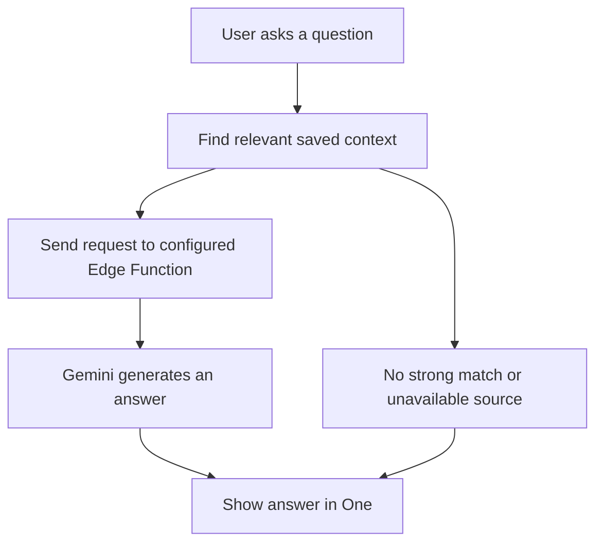

# One — Your Personal AI Assistant

**One** is a general-purpose personal assistant and lightweight, installable web workspace. It is designed for students, professionals, freelancers, and anyone who wants a simpler place to organize everyday life and work.

Use One to capture information, keep track of tasks and projects, record expenses or money owed, build a personal knowledge base, and ask questions about information you have saved. Learning and study workflows are supported use cases, but One is not limited to students.

> One is an evolving MVP. Review the privacy and limitations notes below before storing sensitive information.

## What you can do with One

- **Notes:** Capture ideas, instructions, meeting notes, and useful information. Notes remain part of your workspace and can be searched or used as context for supported AI answers.
- **Tasks and planning:** Keep track of to-dos, due dates, priorities, and completion. Use the planner to review what needs attention.
- **Projects:** Keep related work and context together so you can return to an ongoing project without starting from scratch.
- **Money & Udhaar:** Record expenses and money lent or borrowed, and review the associated totals and entries.
- **Personal knowledge:** Save useful facts and learning material. Add supported PDFs or images to extract text and make relevant information available to retrieval.
- **Ask My Brain / Ask AI:** Ask natural-language questions. The retrieval flow searches relevant saved workspace information and, when available, document text, then provides an answer grounded in matching context. Results depend on what was saved, extracted, and indexed; AI can still be incomplete or wrong.
- **Backup and restore:** Export workspace data as JSON and restore a validated backup. A safety snapshot is made before restore.
- **Installable web app:** Use the responsive interface on desktop or mobile and install it where the browser supports PWA installation.

Feature availability can depend on the version deployed, account state, configured services, and browser support.

## Run locally

### Requirements

- Git
- A modern browser
- A local static HTTP server (VS Code Live Server is one option)

### Steps

1. Clone or download this repository.
2. Open the project folder in VS Code.
3. Start a local server using **Live Server** or another static server.
4. Open the server URL in your browser (for example, `http://localhost:5500`).
5. If you change files, refresh the page to see the changes.

This is currently a static HTML/CSS/JavaScript app; no package install or build command is required for the basic frontend.

**Important:** Do not open the page directly as `file:///.../index.html`. Service workers, microphone permissions, and PWA installation need a secure context. Use `http://localhost` (treated as secure by modern browsers) or an HTTPS deployment. Microphone access also requires browser permission and compatible hardware.

### Common local-run issues

- **Blank page or missing assets:** Start the server from the repository root so relative paths resolve correctly.
- **PWA install or service worker unavailable:** Confirm the URL is localhost or HTTPS; private/incognito modes and browser settings may restrict installation.
- **Microphone not working:** Allow microphone access in the browser, check the selected input device, and verify browser support.
- **Old version still appears:** Hard-refresh the page. If a service worker is active, close other app tabs and reload after the deployment/update has completed.

## AI setup

Ask AI relies on a separately configured Supabase Edge Function and Gemini. The frontend alone does not provision or deploy these services.

### Setup checklist

- [ ] Create or select a Supabase project.
- [ ] Review and apply the required database schema and Row Level Security (RLS) policies for the features you enable.
- [ ] Configure the app's Supabase project URL and public publishable/anon key in the appropriate frontend configuration.
- [ ] Deploy the Ask AI Edge Function to your Supabase project.
- [ ] Add the Gemini API key as a **Supabase Edge Function secret**. Do not place it in HTML, JavaScript, a public repository, or frontend environment variables.
- [ ] Test a simple question, a question that should match a saved note, and a question with no matching context.
- [ ] Check the function logs and browser console if a request fails.

### How the request flows

The actual context available to AI depends on the data you have saved and the retrieval/document-processing features enabled. Do not assume every uploaded file is fully indexed or every answer has been independently verified.

**Deployment note:** Pushing the Edge Function source to GitHub does not deploy it to Supabase. Deploy the function separately using the Supabase tooling and project you intend to use.

## Data, privacy, and security

- **Local data:** One can persist workspace information in browser storage. Browser data can be lost when site data is cleared, a browser profile is removed, or a device is lost.
- **Backups:** Export a JSON backup regularly and before testing restore, clearing browser data, or moving to another device. Keep the backup somewhere safe.
- **Uploaded files:** Extracted text and workspace records may be stored locally. Original PDFs/images may remain in browser IndexedDB and may not be included in a JSON workspace export.
- **AI processing:** Relevant excerpts and eligible file content may be sent to the configured AI service to answer a question. Avoid submitting sensitive personal, financial, medical, or confidential work information unless you understand and accept the service provider's terms.
- **Cloud sync:** Cloud behavior depends on Supabase availability, authentication, schema, and correct RLS policies. A visible public anon/publishable key is not a substitute for access control.
- **Secrets:** Never expose a Supabase service-role key or Gemini API key in client-side code. Keep privileged keys on trusted server-side infrastructure.
- **Access control:** Apply least-privilege RLS policies and test them with separate users. Do not assume that a table is private simply because the app has a login screen.
- **MVP status:** One is not a production-grade secure document vault, guaranteed backup service, or complete cloud synchronization system.

Useful references:
- [MDN: Secure contexts](https://developer.mozilla.org/en-US/docs/Web/Security/Secure_Contexts)
- [Supabase: Row Level Security](https://supabase.com/docs/guides/database/postgres/row-level-security)
- [Supabase: Edge Functions](https://supabase.com/docs/guides/functions)
- [GitHub Pages documentation](https://docs.github.com/en/pages)

## Deploy to GitHub Pages

### Step-by-step

1. Push the project to your GitHub repository and open the repository page.
2. Select **Settings → Pages**.
3. Under **Build and deployment**, choose the correct source:
   - **Deploy from a branch:** select the intended branch (usually `main`) and folder (usually `/(root)`), then save; or
   - **GitHub Actions:** select the workflow configured for this repository.
4. Open the **Actions** tab and wait for the Pages workflow/deployment to complete successfully, if a workflow is used.
5. Open the published **HTTPS** address shown in Pages settings.
6. Test the deployed app in a fresh tab and on mobile: navigation, notes/tasks, Ask AI (if configured), backup/restore, and install/update behavior.

### Common deployment problems

- **404 or wrong page:** Verify the Pages source branch/folder and that the entry HTML file is in the selected location.
- **CSS/JS missing on a project site:** Check relative asset paths; a repository-hosted Pages URL includes the repository path.
- **Changes do not appear:** Confirm the deployment completed, then hard-refresh. Check that the commit was pushed to the branch Pages actually deploys.
- **Installed PWA still shows old assets:** Update the cache version in `service-worker.js` when changing cached assets, commit, and redeploy. Then reopen the installed app and allow the service worker to activate.
- **AI request fails:** Confirm the frontend Supabase configuration, function deployment, Gemini secret, function logs, and RLS policies. Frontend deployment does not automatically deploy the Edge Function.
- **Cloud data unavailable:** Check authentication, network, schema/migrations, and RLS. Do not disable RLS as a quick fix.

## Current limitations and practical workarounds

| Limitation | Workaround |
| --- | --- |
| Browser-local data is not a guaranteed backup. | Export JSON regularly; keep a copy outside the browser/device. |
| Original uploaded files may not be included in workspace JSON backups. | Keep the original PDF/image separately and re-upload it when needed. |
| Cloud sync and cross-device merge are not a complete sync engine. | Use the same account where supported, export/import backups carefully, and avoid editing the same data on multiple devices until sync behavior is verified. |
| AI depends on network access, configured services, and free-tier quotas. | Use available local notes/search/actions when AI is unavailable; retry later if a quota or service limit is reached. |
| Retrieval/OCR can miss content or return incomplete answers. | Use clear, text-based documents where possible; verify important answers against the source and add the relevant text as a note if needed. |
| OCR quality varies with scan clarity, language, and device performance. | Upload a sharper, upright image or searchable PDF; check extracted text before relying on it. |
| No guaranteed scheduled reminders or production file-storage pipeline. | Review the planner manually and maintain a separate reminder/backup for critical deadlines or files. |
| The project is an evolving MVP, not a hardened enterprise application. | Avoid storing highly sensitive data and test access/privacy settings before enabling cloud features. |

## Contributing

Issues and pull requests are welcome. When reporting a bug, include the browser/device, steps to reproduce, expected behavior, and any relevant console error. Never include API keys, passwords, or private user data in an issue.
